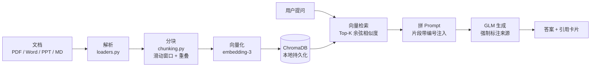

# 个人 RAG 知识库助手


把散落在本机的 PDF、Word、PPT、Markdown 变成**可溯源**的问答知识库。

问它问题时，它**只依据你的文档**作答，并标注每条结论来自哪份文件的哪个片段 ——
PDF 精确到页码、PPT 到页序，还会给出相似度。**能核对，才敢信任。**


## 效果演示

上图是真实运行效果：提问「CSMA/CD 协议的工作原理」，模型**严格依据 PDF 原文**作答，
答案里每条结论都带 `[1]` `[2]` 引用编号；下方引用卡片展开即可看到原文位置
（`FX.pdf · 第 2 页 · 相似度 76%`）。

四条防线保证它不胡说：

| 机制 | 做法 |
|---|---|
| **准确回答** | 召回片段按编号拼进 Prompt，要求模型"看着材料回答" |
| **精确引用** | 每条结论标注来源编号，点击可展开原文，附文件 / 页码 / 相似度 |
| **防幻觉** | 要求模型在材料不足时明确说明，不得自行编造 |
| **无命中兜底** | 检索为空时直接返回引导语，不硬凑答案 |

## 功能特性

| 功能 | 说明 |
|---|---|
| 文档上传与解析 | 支持 PDF / Word(docx) / PPT(pptx) / Markdown / 纯文本 / 常见代码文件，网页上传（含拖拽）或直接放进 `data/` |
| 智能分块 | 滑动窗口 + 自然断句优先，相邻块带重叠，避免语义被硬切断 |
| 向量化入库 | 调用智谱 `embedding-3` 生成向量，持久化到本地 ChromaDB |
| 增量索引 | 按文件内容 SHA-256 判断变化，只重建新增/修改的文件，自动清理已删除文件 |
| 相似度检索 | Top-K 余弦相似度召回，K 值可调 |
| 基于上下文的生成 | 召回片段按编号拼进 Prompt，要求模型"看着材料回答"、不得编造 |
| 来源引用 | 回答里的 `[1]` 渲染成引用角标；引用卡片显示文件、页码、相似度进度条，可展开原文并一键复制 |
| 答案渲染 | 轻度 Markdown（标题 / 有序无序列表 / 行内代码 / 粗体），文档内容全部转义后再渲染 |
| 移动端适配 | 响应式布局，手机上可正常问答 —— 方便扫码演示 |
| 网页设置面板 | 在界面上直接填写 API Key 与模型参数，保存即写回 `.env` 并立即生效，无需重启 |
| 访问口令 | 可选开启，公网部署时防止陌生人消耗你的 API Key |
| 本地网页界面 | 聊天式交互，支持拖拽上传、示例问题一键提问、建库报告卡片 |

## 工作原理



**增量索引**：每个文件算 SHA-256 存进 `storage/manifest.json`，入库前比对，
只处理变化的文件 —— 知识库变大后这点很关键。

## 技术选型

| 环节 | 选型 |
|---|---|
| 后端 | FastAPI（自带 Swagger 文档，访问 `/docs`） |
| 向量库 | ChromaDB（本地持久化，零运维） |
| 大模型 / Embedding | 智谱 GLM（OpenAI 兼容接口，一个 Key 通用） |
| 文档解析 | PyMuPDF / python-docx / python-pptx / 原生读取 |
| 前端 | 原生 HTML + JS，无需构建 |
| 测试 | pytest（82 项） |

> 说明：**未引入 LangChain**。本项目链路只有「检索 → 拼 Prompt → 调用模型」，
> 原生实现更短更透明、出错好定位；等将来需要多路检索或 Agent 编排时再评估。

## 目录结构

```
.
├─ src/
│  ├─ config.py      # 配置（环境变量 / .env，支持运行期更新）
│  ├─ loaders.py     # 各格式文档解析，产出 (文本, 位置)
│  ├─ chunking.py    # 分块策略
│  ├─ llm.py         # 智谱 Embedding 与 Chat 调用
│  ├─ store.py       # Chroma 集合管理
│  ├─ ingest.py      # 建库流水线 + 增量索引
│  ├─ retrieve.py    # Top-K 检索
│  ├─ generate.py    # Prompt 组装与带引用生成
│  └─ server.py      # FastAPI 接口
├─ web/index.html    # 前端聊天界面 + 设置面板
├─ tests/            # pytest 测试
├─ docs/             # 截图与部署文档
├─ data/             # 你的文档放这里（不入版本库）
└─ storage/          # 向量库与索引清单落盘（不入版本库）
```

## 快速开始（本地）

**1. 安装依赖**

```bash
python -m venv .venv
source .venv/bin/activate        # Windows: .venv\Scripts\activate
pip install -r requirements.txt
```

**2. 启动服务**

```bash
uvicorn src.server:app --reload
```

打开 <http://127.0.0.1:8000> 。

**3. 配置 API Key（二选一）**

- **方式 A（推荐）**：在网页右上角点「设置」，粘贴 Key 后保存。配置会写入
  项目根目录的 `.env` 并**立即生效**，不需要重启服务。未配置时页面会自动弹出设置面板。
- **方式 B**：复制 `.env.example` 为 `.env`，填入在
  <https://bigmodel.cn/usercenter/apikeys> 申请的 Key，然后重启服务：

  ```
  ZHIPUAI_API_KEY=你的key
  ```

配好后上传文档即可提问，接口文档在 `/docs`。

## Docker 部署

```bash
cp .env.example .env      # 先填好 ZHIPUAI_API_KEY（公网部署务必再设 APP_PASSWORD）
docker compose up -d --build
```

访问 <http://服务器IP:8000>。数据与向量库通过 volume 挂载在宿主机的
`./data` 与 `./storage`，容器重建不丢。

完整步骤（含云服务器选购、安全组、Nginx 反代与 HTTPS）见
**[docs/DEPLOY.md](docs/DEPLOY.md)**。

> ⚠️ **部署到公网前请务必设置 `APP_PASSWORD`**。服务不设口令时任何人访问你的地址
> 都能调用 `/query` 消耗你的 API Key 额度。

## 配置项

全部通过环境变量或 `.env` 覆盖，也可以在网页「设置」面板里改。默认值见 `src/config.py`。

| 变量 | 默认值 | 说明 |
|---|---|---|
| `ZHIPUAI_API_KEY` | 无 | 必填，智谱 API Key |
| `APP_PASSWORD` | 空 | 可选，访问口令；设置后浏览器会弹出登录框（用户名随意，密码即此值） |
| `CHAT_MODEL` | `glm-5.2` | 对话模型（如不可用可改 `glm-5.1` 等） |
| `EMBED_MODEL` | `embedding-3` | 向量模型，改动后需重建索引 |
| `EMBED_DIM` | `1024` | 向量维度，改动后需重建索引 |
| `CHUNK_SIZE` | `800` | 分块最大字符数 |
| `CHUNK_OVERLAP` | `120` | 相邻块重叠字符数 |
| `TOP_K` | `5` | 默认召回条数 |

## 接口

| 方法 | 路径 | 说明 |
|---|---|---|
| GET | `/` | 聊天界面 |
| GET | `/health` | 健康检查 |
| GET | `/settings` | 读取当前配置（API Key 只返回脱敏提示） |
| POST | `/settings` | 保存配置并写回 `.env`，立即生效 |
| POST | `/upload` | 上传文档（multipart，字段名 `files`），自动增量建库 |
| POST | `/ingest` | 重建索引，body `{"force": false}`；`force=true` 全量重建 |
| POST | `/query` | 提问，body `{"question": "...", "top_k": 5}` |

## 测试

```bash
pytest
```

82 项测试全部使用桩对象，不发起真实 API 调用，也不会改动真实的 `.env`。

## 后续规划（V2+）

- 混合检索（BM25 + 向量）与 Rerank 重排
- 元数据过滤（按文件 / 标签 / 时间）
- 多轮对话与追问改写
- 文档管理界面（列表、删除、重新索引）
