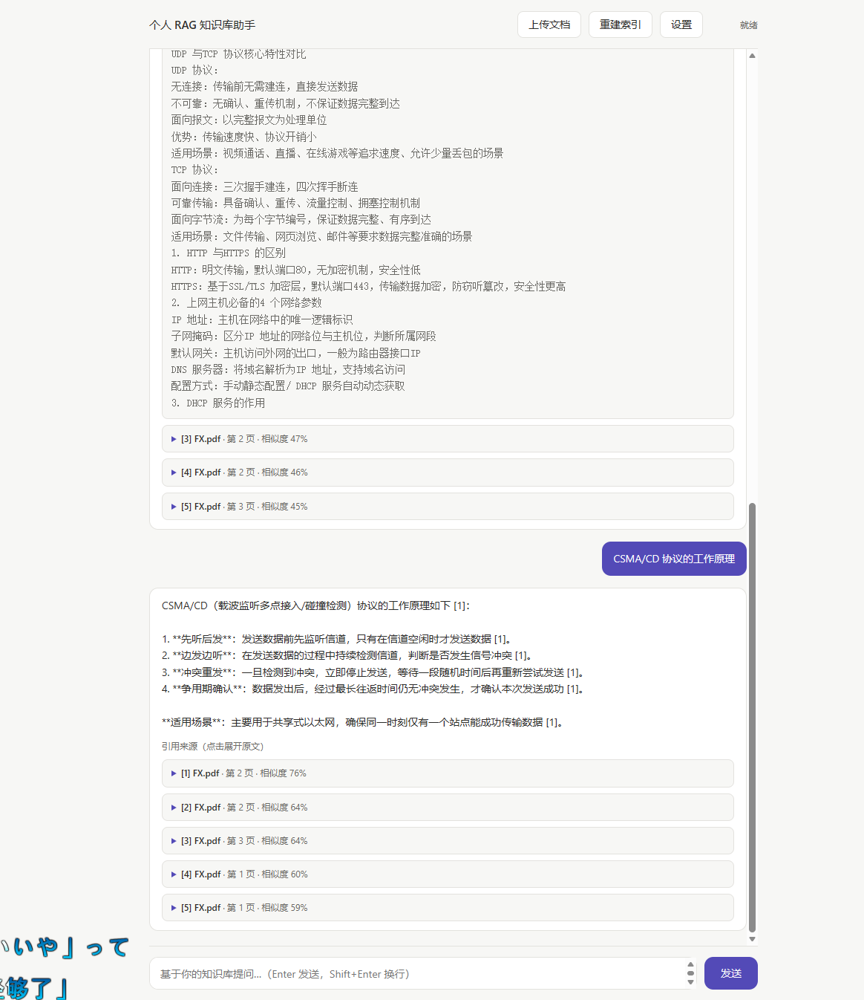
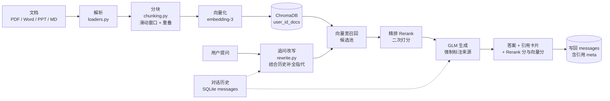

# 个人 RAG 知识库助手


## ⚠️ 部署前必读（安全）

**本项目不执行 AI 生成的代码，无代码执行风险。生产部署必须设置 `JWT_SECRET`、
强管理员口令（严禁使用弱口令）并启用 HTTPS。关于代码执行层的隔离设计与威胁模型，
请参见姊妹项目 `data-analyst-agent` 的相关文档（`docs/sandbox-threat-model.md`
与 `docs/executor-interface.md`）。**

三点说明：

- **`JWT_SECRET` 必填**：`APP_ENV != dev` 时服务启动即校验，缺了**直接拒绝启动** ——
  随机生成的密钥只落在 `storage/`，容器重建即丢，所有人会被静默强制重新登录；
  多实例部署更是各签各的，请求落到另一台就 401。
- **管理员口令零弱口令**：不设 `ADMIN_PASSWORD` 时生成随机强口令并**强制首次登录改密**
  （改密前除 `/api/auth/me` 外一律 403）；显式设了弱口令（如 `admin123`）服务**拒绝启动**。
- **必须启用 HTTPS**：登录态走 `Authorization: Bearer <token>`，明文 HTTP 下 token
  可被中间人截获，等同于账号泄露。


把散落在本机的 PDF、Word、PPT、Markdown 变成**可溯源**的问答知识库。
多用户共用一套服务，但**每个人的文档、向量库、会话都互相看不见**。

问它问题时，它**只依据你的文档**作答，并标注每条结论来自哪份文件的哪个片段 ——
PDF 精确到页码、PPT 到页序，还会给出精排分与相似度。**能核对，才敢信任。**



## 效果演示

上图是真实运行效果 —— 同一份 PDF（`FX.pdf`）上连续两问：先问「集线器和交换机有什么区别？」，
再**用指代追问**「那它的优势是什么？」。

- **答案严格依据原文**：模型只在召回片段范围内组织回答，每条结论都带 `[1]` 引用编号
- **多轮上下文接得住**：第二问只说了「它」，系统结合上一轮把指代补全后再去检索，
  答案直接锁定「交换机的优势」，不硬猜也不跑偏
- **改写过程可见**：答案下方一行「检索用的问题已改写为 **集线器的优势是什么？**」，
  把这次隐性改写摊开给你核对，而不是藏在黑盒里
- **两个分数可对照**：每条引用同时显示 `RERANK 16`（本次排序依据，进度条按本次最高分归一）
  与 `向量 48%`（语义相似度，留作对照）。接口默认返回的归一化分在候选彼此都相关时会
  一起饱和到 `1.0`，所以这里取的是**原始打分**
- **引用可核对**：下方「引用来源 · 5 条」列出命中片段，标注 `文件名 · 页码`，
  展开即可看到原文，可一键复制

四条防线保证它不胡说：

| 机制 | 做法 |
|---|---|
| **准确回答** | 召回片段按编号拼进 Prompt，要求模型"看着材料回答" |
| **精确引用** | 每条结论标注来源编号，点击可展开原文，附文件 / 页码 / Rerank 分与向量分 |
| **防幻觉** | 要求模型在材料不足时明确说明，不得自行编造 |
| **无命中兜底** | 检索为空时直接返回引导语，不硬凑答案 |

## 功能特性

| 功能 | 说明 |
|---|---|
| **用户系统** | 注册 / 登录（bcrypt 口令哈希 + JWT），登录态 7 天，可改密；账号可被管理员禁用 |
| **多用户数据隔离** | 每个用户一套独立的**数据目录 / 增量索引清单 / 向量集合**（`user_<id>_docs`），互不可见；越权访问一律 404，不泄露资源是否存在 |
| **会话持久化** | 聊天记录落在 SQLite（`sessions` / `messages`），服务重启不丢；左侧会话栏可新建 / 切换 / 重命名 / 删除，切换即恢复历史消息与引用卡片 |
| **管理员后台** | 独立页面：全站统计、用户管理（搜索 / 改角色 / 禁用 / 重置密码）、查看任意用户完整聊天记录、跨用户文档管理与只读预览、重建索引 / 清缓存 / 健康状态 |
| 文档上传与解析 | 支持 PDF / Word(docx) / PPT(pptx) / Markdown / 纯文本 / 常见代码文件，网页上传（含拖拽） |
| 智能分块 | 滑动窗口 + 自然断句优先，相邻块带重叠，避免语义被硬切断 |
| 向量化入库 | 调用智谱 `embedding-3` 生成向量，持久化到本地 ChromaDB |
| 增量索引 | 按文件内容 SHA-256 判断变化，只重建新增/修改的文件，自动清理已删除文件 |
| 相似度检索 | Top-K 余弦相似度召回，K 值可调 |
| 精排（Rerank） | 先宽召回一批候选，再用智谱 `rerank` 模型二次打分截取 Top-K。取**原始打分** —— 接口默认给的归一化分在候选彼此都相关时会一起饱和到 `1.0`，完全看不出高下；引用卡片同时显示 Rerank 分与向量分 |
| 多轮对话 | 历史由**服务端从数据库读取**并回填给追问改写与生成，前端不再携带 history；追问「它的优势是什么」也接得上 |
| 追问改写 | 带指代的追问先用模型补全成可独立检索的问题再去查库，并把改写结果显示在答案下方 |
| 基于上下文的生成 | 召回片段按编号拼进 Prompt，要求模型"看着材料回答"、不得编造 |
| 来源引用 | 回答里的 `[1]` 渲染成引用角标；引用卡片显示文件、页码、相似度进度条，可展开原文并一键复制。**答案里一个角标都没有时不展示引用卡片** —— 检索是照常做的，但模型没用到的材料不该挂在答案下面冒充依据 |
| 答案渲染 | 轻度 Markdown（标题 / 有序无序列表 / 行内代码 / 粗体），文档内容全部转义后再渲染 |
| 移动端适配 | 响应式布局，手机上可正常问答 —— 方便扫码演示 |
| 网页设置面板 | **仅管理员可见可改**：在界面上直接填写 API Key 与模型参数，保存即写回 `.env` 并立即生效，无需重启 |
| 本地网页界面 | 聊天式交互，支持拖拽上传、示例问题一键提问、建库报告卡片 |

## 多用户与权限

### 角色与权限矩阵

| 能力 | 普通用户 `user` | 管理员 `admin` |
|---|---|---|
| 上传文档 / 建库 / 问答 | ✅ 仅限自己的数据 | ✅ 仅限自己的数据 |
| 会话与消息 | ✅ 仅限自己的会话 | ✅ 自己的 + **可查看任意用户的完整记录** |
| 文档列表与删除 | ✅ 仅限自己的 | ✅ 全站文档 + 只读预览 |
| 站点设置（API Key / 模型 / 检索参数） | ❌ 403 | ✅ |
| `/api/admin/*`（用户 / 会话 / 文档 / 系统） | ❌ 403 | ✅ |
| 重建索引 | ✅ 仅自己 | ✅ 自己 + 全站 |

两条刻意的设计：

- **越权返回 404 而不是 403**。「这个资源不属于你」和「这个资源不存在」必须长得一样，
  否则攻击者能靠状态码枚举出别人的会话 id。
- **权限闸门只在服务端**。前端隐藏按钮只是别让人误点，`require_admin` 才是真闸门；
  普通用户直接 `curl /api/admin/users` 一样是 403。

### 默认管理员

全新部署（`users` 表为空）时，服务启动会自动引导一个管理员账号 `admin`。
**这里没有"默认口令"这种东西** —— 一个全站可见的固定口令，等于把"部署到公网后
忘记改"变成必然事件。口令只有两条来源：

| 情况 | 行为 |
|---|---|
| `.env` 里**留空** `ADMIN_PASSWORD`（默认） | 系统**生成随机强口令**，在启动日志里用醒目横幅打印**一次**；该账号 `must_change_password=True`，改密前除 `/api/auth/me` 与改密接口外**一律 403**，且新口令必须够强（防止一次改成 `123456` 绕过整套策略） |
| `.env` 里**填了** `ADMIN_PASSWORD` | 直接用它，不强制改密。但**弱口令会让服务拒绝启动**：要求 ≥12 位、至少 3 类字符（大小写/数字/符号），且不在常见弱口令表里（`admin123` 会被明确拒绝并打印生成命令） |

引导是幂等的：表里已有用户就不会重复创建。

> 拿到随机口令后，除了在网页上改，也可以直接改：
> ```bash
> curl -X POST http://127.0.0.1:8000/api/auth/change-password \
>   -H "Content-Type: application/json" \
>   -H "Authorization: Bearer <登录接口返回的 token>" \
>   -d '{"old_password":"<横幅里的口令>","new_password":"<新的强口令>"}'
> ```

### 认证方式

除 `GET /health` 与三个页面（`/`、`/login`、`/admin`）外，**所有接口都需要登录态**：

```
Authorization: Bearer <token>
```

token 是 HS256 签名的 JWT（payload 含 `sub` / `username` / `role` / `exp`），
由 `/api/auth/login` 或 `/api/auth/register` 下发，前端存在 `localStorage.auth_token`。
失效或被禁用时返回 401 / 403，前端会自动清掉 token 并跳回登录页。

## 工作原理



**一个刻意的分工**：

- **检索不交给模型决定**。知识库检索固定在流水线里前置完成 —— 引用溯源是这个项目的根基，
  让模型自己判断"要不要查库"反而会让它更爱自由发挥。

**增量索引**：每个文件算 SHA-256 存进 `storage/manifests/user_<id>.json`，入库前比对，
只处理变化的文件 —— 知识库变大后这点很关键。

## 技术选型

| 环节 | 选型 |
|---|---|
| 后端 | FastAPI（自带 Swagger 文档，访问 `/docs`） |
| 用户与持久化 | SQLAlchemy 2.0 + SQLite（`storage/app.db`，零运维）；口令用 `bcrypt` 直接加盐哈希，登录态用 `PyJWT`（HS256） |
| 向量库 | ChromaDB（本地持久化，每用户一个集合） |
| 大模型 / Embedding | 智谱 GLM（OpenAI 兼容接口，一个 Key 通用） |
| 精排 | 智谱 `rerank`（**非** OpenAI 兼容协议，直接发 HTTP 请求，复用同一个 Key） |
| 文档解析 | PyMuPDF / python-docx / python-pptx / 原生读取 |
| 前端 | 原生 HTML + JS，无需构建，**不引任何 CDN** |
| 测试 | pytest（390 项） |

> 说明：**未引入 LangChain**。本项目链路只有「检索 → 拼 Prompt → 调用模型」，
> 原生实现更短更透明、出错好定位；等将来需要多路检索或 Agent 编排时再评估。

## 目录结构

```
.
├─ src/
│  ├─ auth/          # 用户系统：models / db / security / deps / api
│  ├─ config.py      # 配置（环境变量 / .env，支持运行期更新）
│  ├─ loaders.py     # 各格式文档解析，产出 (文本, 位置)
│  ├─ chunking.py    # 分块策略
│  ├─ llm.py         # 智谱 Embedding 与 Chat 调用
│  ├─ store.py       # Chroma 集合管理（按用户取集合）
│  ├─ ingest.py      # 建库流水线 + 增量索引
│  ├─ retrieve.py    # 向量召回 + 精排重排序
│  ├─ rewrite.py     # 追问改写：把指代补全成可独立检索的问题
│  ├─ pipeline.py    # 编排：改写 → 召回精排 → 生成
│  ├─ generate.py    # Prompt 组装与带引用生成
│  ├─ userspace.py   # 每个用户的目录 / 清单 / 集合名
│  ├─ documents.py   # documents 表同步与删除（含删除钩子兜底）
│  ├─ serializers.py # 会话与消息的 JSON 序列化
│  ├─ admin_api.py   # /api/admin/* 管理员接口
│  └─ server.py      # 用户侧 FastAPI 接口
├─ web/
│  ├─ login.html     # 登录 / 注册
│  ├─ index.html     # 工作台：会话栏 + 聊天区 + 设置面板（仅管理员）
│  └─ admin.html     # 管理后台
├─ tests/            # pytest 测试
├─ docs/             # 截图与部署文档
├─ data/users/<id>/  # 每个用户的文档放这里（不入版本库）
└─ storage/          # app.db / secret.key / manifests / 向量库（不入版本库）
```

## 快速开始（本地）

**1. 安装依赖**

```bash
python -m venv .venv
source .venv/bin/activate        # Windows: .venv\Scripts\activate
pip install -r requirements.txt
```

**2. 启动服务**

```bash
uvicorn src.server:app --reload
```

打开 <http://127.0.0.1:8000> ，会跳到登录页。首次启动的管理员口令，要么是你设的
`ADMIN_PASSWORD`，要么是**启动日志横幅里那串随机口令**（只打印一次，请及时保存），
后者登录后必须先改密。**自助注册默认关闭**（`ALLOW_REGISTRATION=false`）——
开通成员时由管理员在服务端把它设为 `true` 并重启，成员注册完再改回 `false`；
只有在这个开关打开时，登录页的「注册」标签才可用。

**3. 配置 API Key（仅管理员）**

- **方式 A（推荐）**：用管理员登录后点右上角「设置」，粘贴 Key 后保存。配置会写入
  项目根目录的 `.env` 并**立即生效**，不需要重启服务。
- **方式 B**：复制 `.env.example` 为 `.env`，填入在
  <https://bigmodel.cn/usercenter/apikeys> 申请的 Key，然后重启服务：

  ```
  ZHIPUAI_API_KEY=你的key
  ```

配好后上传文档即可提问，接口文档在 `/docs`。

> 普通用户看不到「设置」按钮，也无法通过接口改站点配置（403）—— API Key 是全站共用的。

## Docker 部署

```bash
cp .env.example .env      # 先填好 ZHIPUAI_API_KEY，并建议同时设 ADMIN_PASSWORD 与 JWT_SECRET
docker compose up -d --build
```

访问 <http://服务器IP:8000>。数据与向量库通过 volume 挂载在宿主机的
`./data` 与 `./storage`，容器重建不丢（**用户、会话、口令哈希都在 `./storage/app.db` 里**）。

> ⚠️ **容器 / 公网部署有两条强制项**（`docker-compose.yml` 已把 `APP_ENV` 设为
> `production`）：
> ① **必须**注入 `JWT_SECRET`，否则服务**直接拒绝启动**（随机密钥只落在容器内的
> `storage/`，重建即丢，所有人被静默强制重登；多实例更是各签各的）；
> ② 用 `ADMIN_PASSWORD` 指定初始管理员口令 —— 留空会走「随机口令 + 强制首次改密」，
> 填弱口令（如 `admin123`）同样会**拒绝启动**。
> 任何人拿到管理员账号都能消耗你的 API Key 额度。

完整步骤（含云服务器选购、安全组、Nginx 反代与 HTTPS）见
**[docs/DEPLOY.md](docs/DEPLOY.md)**。

## 配置项

全部通过环境变量或 `.env` 覆盖，也可以在网页「设置」面板里改（**仅管理员**）。
默认值见 `src/config.py`。

| 变量 | 默认值 | 说明 |
|---|---|---|
| `ZHIPUAI_API_KEY` | 无 | 必填，智谱 API Key |
| `CHAT_MODEL` | `glm-5.2` | 对话模型（如不可用可改 `glm-5.1` 等） |
| `EMBED_MODEL` | `embedding-3` | 向量模型，改动后需重建索引 |
| `EMBED_DIM` | `1024` | 向量维度，改动后需重建索引 |
| `CHUNK_SIZE` | `800` | 分块最大字符数 |
| `CHUNK_OVERLAP` | `120` | 相邻块重叠字符数 |
| `TOP_K` | `5` | 默认召回条数 |
| `HISTORY_TURNS` | `6` | 多轮对话携带的历史轮数，`0` 表示不记忆上下文 |
| `QUERY_REWRITE` | `true` | 追问改写开关 |
| `RERANK_ENABLED` | `true` | 精排开关；关掉也能用，只是召回精度降一档 |
| `RERANK_MODEL` | `rerank` | 精排模型编码 |
| `RERANK_CANDIDATES` | `20` | 送入精排的候选条数（接口上限 128） |
| `JWT_SECRET` | dev 下自动生成 | JWT 签名密钥。**`APP_ENV != dev` 时必填，缺了直接拒绝启动**；dev 下不设则随机生成并持久化到 `storage/secret.key`（重启不失效）。多实例部署必须显式设置且保持一致 |
| `APP_ENV` | `dev` | `dev` / `production`。非 `dev` 即视为生产，强制要求外部注入 `JWT_SECRET`（`docker-compose.yml` 已设为 `production`） |
| `JWT_EXPIRE_HOURS` | `168` | 登录态有效期（小时），默认 7 天 |
| `ADMIN_USERNAME` | `admin` | 首次启动引导的管理员用户名 |
| `ADMIN_EMAIL` | `admin@example.com` | 首次启动引导的管理员邮箱 |
| `ADMIN_PASSWORD` | 空（随机生成） | 首次启动引导的管理员口令。**没有默认口令**：留空则生成随机强口令、启动横幅打印一次并强制首次改密；填入弱口令（<12 位 / <3 类字符 / 命中弱口令表）会**拒绝启动** |
| `ALLOW_REGISTRATION` | `false` | 是否允许自助注册。**默认关闭**：公网部署下任何人注册成功都会消耗**站点共用**的 API Key 额度。要开通成员时临时设为 `true` 并重启，开通完改回 `false` |
| `LOGIN_MAX_FAILURES` | `5` | 同一账号连续登录失败多少次后锁定 |
| `LOGIN_LOCK_SECONDS` | `300` | 锁定时长（秒）。锁定期内登录返回 429 + `Retry-After` |
| `MAX_UPLOAD_SIZE` | `52428800` | 单次上传请求的**总体积**上限（字节，默认 50 MiB）。超限返回 413；多文件共享同一份预算 |
| `STORAGE_DIR` | `<仓库>/storage` | 落盘根目录（SQLite、索引清单、向量库） |
| `DATA_DIR` | `<仓库>/data` | 文档根目录，实际按 `users/<id>/` 分用户存放 |

## 接口

除 `GET /health` 与页面外，全部需要 `Authorization: Bearer <token>`。

| 方法 | 路径 | 说明 |
|---|---|---|
| GET | `/` | 工作台页面（无 token 时前端跳登录页） |
| GET | `/login` | 登录 / 注册页面 |
| GET | `/admin` | 管理后台页面（普通用户前端提示无权限，服务端接口才是真闸门） |
| GET | `/health` | 健康检查（公开） |
| POST | `/api/auth/register` | 注册，body `{"username","email","password"}`（口令 ≥ 6 位）；注册即登录，返回 `{"token","user"}` |
| POST | `/api/auth/login` | 登录，body `{"account","password"}`；`account` 可填用户名或邮箱 |
| GET | `/api/auth/me` | 当前登录用户 |
| POST | `/api/auth/change-password` | 改密，body `{"old_password","new_password"}` |
| POST | `/upload` | 上传文档（multipart，字段名 `files`），自动增量建库（限本人）；总量超过 `MAX_UPLOAD_SIZE` 返回 **413** |
| POST | `/ingest` | 重建索引，body `{"force": false}`；`force=true` 全量重建 |
| GET | `/api/documents` | 当前用户的文档列表 |
| DELETE | `/api/documents/{id}` | 删除文档（删文件 → 清向量 → 删清单 → 删表行；文件删不掉时改名挪开） |
| GET | `/api/sessions` | 会话列表 |
| POST | `/api/sessions` | 新建会话，body `{"title": "可选"}` |
| GET | `/api/sessions/{id}/messages` | 某会话的全部消息（含 assistant 的引用 meta） |
| PATCH | `/api/sessions/{id}` | 重命名会话 |
| DELETE | `/api/sessions/{id}` | 删除会话（消息级联删除） |
| POST | `/query` | 提问，body `{"question": "...", "top_k": 5, "session_id": 可选}`；**历史由服务端按 `session_id` 从库里取**，返回 `answer`、`citations`、`query`、`rewritten`、`session_id` |
| GET | `/settings` | 读取当前配置（**仅管理员**；API Key 只返回脱敏提示） |
| POST | `/settings` | 保存配置并写回 `.env`（**仅管理员**），立即生效 |

管理员接口（前缀 `/api/admin`，全部需要 `admin` 角色）：

| 方法 | 路径 | 说明 |
|---|---|---|
| POST | `/users` | **管理员建号**：body `{username, email, role?}`；口令由服务端生成、**只在响应里返回一次**（库里只存哈希），该账号首次登录必须先改密 |
| GET | `/users` | 用户列表 / 搜索（`?q=` 匹配用户名或邮箱） |
| PATCH | `/users/{id}` | 改角色 / 启禁用（不能降级或禁用自己的账号） |
| POST | `/users/{id}/reset-password` | 重置口令；不传 `password` 则生成随机口令，只在响应里出现一次 |
| GET | `/sessions` | 全站会话列表（`?user_id=` 过滤） |
| GET | `/sessions/{id}/messages` | 查看任意用户的完整聊天记录（含引用） |
| DELETE | `/sessions/{id}` | 删除任意会话 |
| GET | `/documents` | 全站文档列表（`?user_id=` 过滤） |
| GET | `/documents/{id}/preview` | 只读预览文档原文（不触发检索） |
| DELETE | `/documents/{id}` | 删除任意文档 |
| POST | `/system/reindex` | 对全部用户分别重建索引，body `{"force": false}` |
| POST | `/system/clear-cache` | 清掉缓存的模型客户端 |
| GET | `/system/health` | 系统状态（不含 Key 明文） |
| GET | `/stats` | 用户 / 会话 / 消息 / 文档计数与近 24h 活跃 |

## 测试

```bash
pytest
```

390 项测试全部使用桩对象，不发起真实 API 调用，也不会改动真实的 `.env`。
其中多用户部分专门覆盖了**跨用户越权**（A 读不到 B 的会话 / 文档，一律 404）、
**普通用户 403**、**禁用用户拒绝登录**、**JWT 过期与伪造拒绝**、
**消息落库后重启不丢**，以及**删除钩子拦截删除时主流程不受影响**。

## 后续规划（V2+）

- 混合检索（BM25 + 向量），补齐关键词精确匹配的短板
- 元数据过滤（按文件 / 标签 / 时间）
- 用户自助删除账号与数据导出
- 团队空间：把「按用户隔离」扩展为「按项目 / 团队共享」
